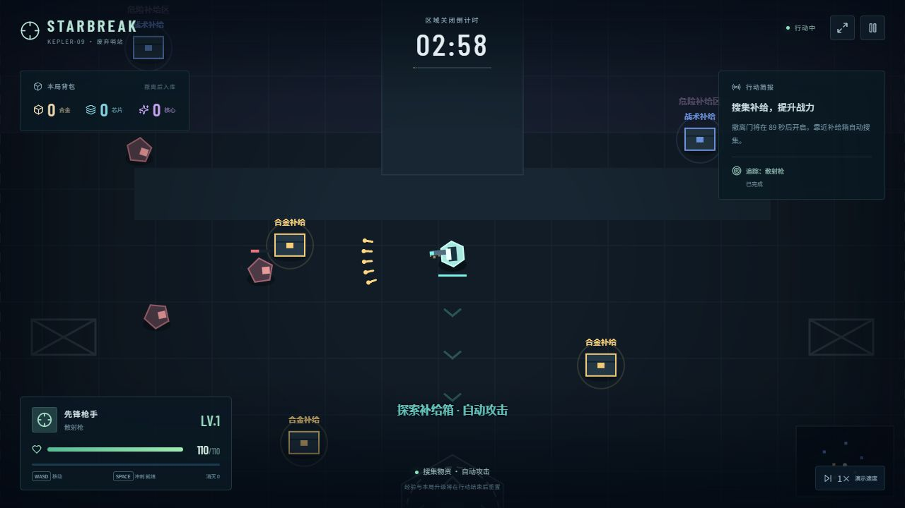
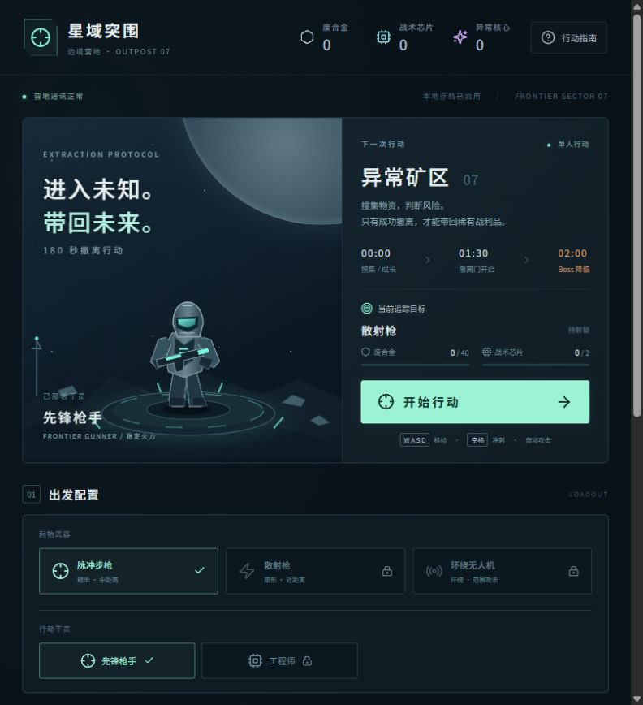
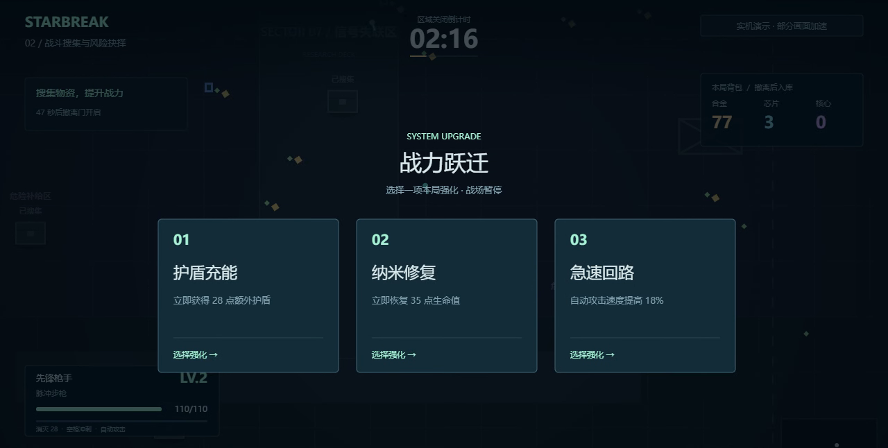
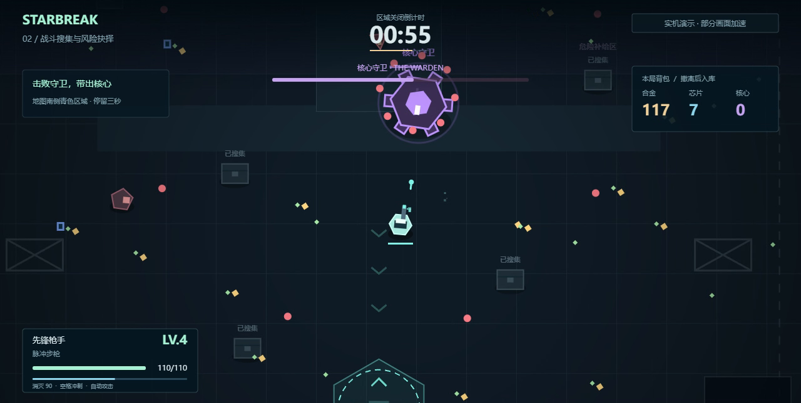
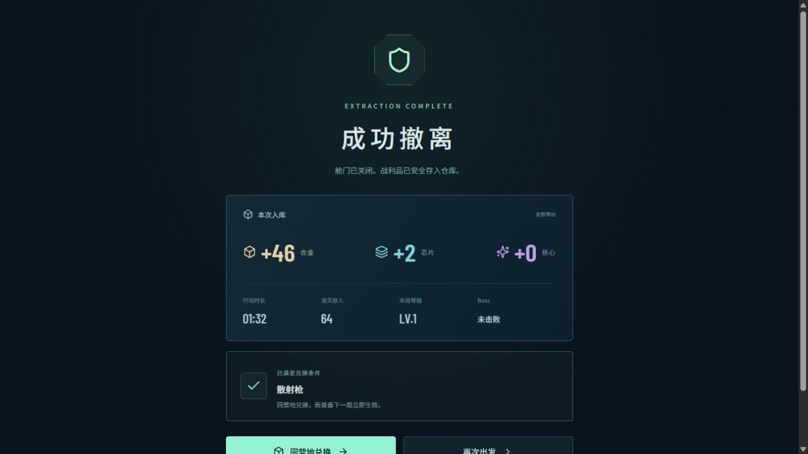
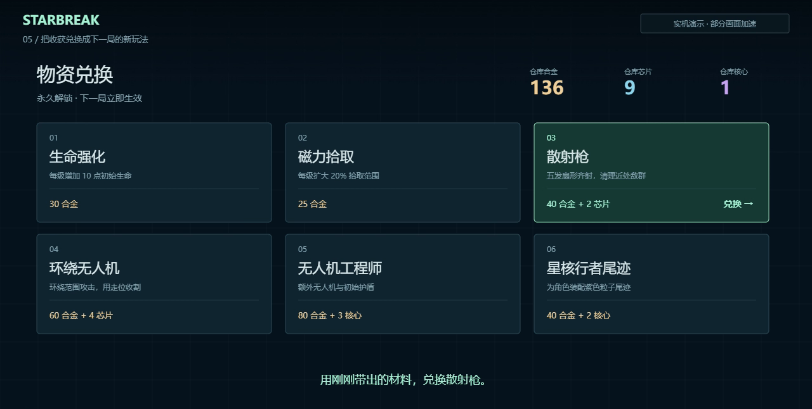

<div align="center">

# 星域突围 · STARBREAK

**自由探索、风险构筑、主动撤离的科幻肉鸽小游戏**

带上有限的模块，进入不断延伸的异常矿区。搜集、强化、挑战守卫，再决定何时带着收获回家。

React 19 · TypeScript · Canvas 2D · Vite

[快速开始](#快速开始) · [游戏玩法](#游戏玩法) · [画面参考](#画面参考) · [四周计划](docs/ROADMAP.md)



*上图为初版画面参考；当前 V3 已重做营地、战斗界面和交战反馈。*

</div>

> **当前版本：V3 前端试玩原型。** 在无限地图、随机补给、模块背包、风险契约、无伤连杀和主动 Boss 挑战的基础上，打磨营地整备、首局目标、敌群追击、战斗状态和音画反馈。战斗、撤离、兑换、解锁与再次出战组成完整本地流程。Go 后端、账号、真实 Xsolla 沙箱支付、RabbitMQ、Datadog 和公司 K8s 部署仍待正式接入。

## 项目介绍

玩家进入由可复用地块构成的异常矿区，利用自动攻击、移动和冲刺应对不同敌人。地图可以继续探索，没有固定的整局倒计时；更深区域和高价值事件带来更高风险。完成两个资源事件后揭示 Boss 据点，由玩家主动决定是否挑战。

战斗中，短时补给提供爆发机会，升级三选一支持本局成长，异常终端提供带有风险的本局契约。出发前装配的模块则决定起始打法：容量有限，玩家需要在防护、搜集、穿透和容错之间取舍。

成功撤离后，材料进入营地仓库，用于扩容、解锁和强化模块，以及原有的武器、角色与外观兑换。已拥有的模块和装备不会因战斗死亡而丢失。

这是五人团队四周课程项目的玩法演示基座。数值、概率、地图密度与成长价格均为试玩配置，不代表已经完成长期平衡。

## V3 这次打磨了什么

- **先知道要做什么：** 首页按「行动／装备／工坊」分开组织。机库展示当前角色、武器与模块；出发旁直接列出成长目标、能力预览、已有材料和缺口。首次行动从搜集资源仓开始，不要求先配置复杂构筑。
- **带着目标再次出发：** 可追踪武器或角色兑换、模块解锁、背包扩容。材料足够时能从行动页兑换；切换武器或角色后，机库干员展示随配置变化。
- **更需要走位的交战：** 调整玩家移速和敌群追击，增加绕障追踪与追击怪的预警冲刺；远程与瞬移敌人继续形成不同压力。目标是让掩体与冲刺更有用，实际难度仍需试玩调优。
- **更容易读懂战场：** 重排血量、护盾、战利品、区域威胁、目标导航和交互提示；短时补给显示剩余时间，状态详情展示模块和契约，界面可选择 100%／125%／150% 大小。
- **让命中和击杀有回应：** 加入角色与敌人精灵、命中闪白、伤害数字、死亡碎片、枪口与拾取反馈，以及浏览器合成音效。音效与轻量震屏可分别关闭；音效需首次按键或点击后启用。

### 第一次试玩建议

1. 在「行动」页点击「首次出击」，按 `WASD` 移动、`Space` 冲刺；武器自动攻击。
2. 跟随金色资源目标，靠近资源仓按 `E` 启动，清理两处资源事件。完成后可以寻找接应站；Boss 挑战是可选项。
3. 在接应站按 `E`，留在圈内防守 10 秒。成功带回后，用 **40 合金＋2 芯片**解锁散射枪，下一局体验扇形齐射。

普通资源仓当前每处提供 28 合金和 2 芯片；先成功撤离，再兑换成长。途中失败只结算部分合金，稀有材料不能带回。

## 快速开始

### 直接试玩

[下载单文件试玩版](https://school-gitlab.xsolla.dev/hailong_wang/starbreak-game/-/raw/main/demo/starbreak-play.html?inline=false)

下载仓库内的 `demo/starbreak-play.html`，用桌面版 Chrome 或 Edge 打开即可。文件内置运行代码与样式，不需要安装 Node.js，也不需要单独发送贴图。

- GitLab 文件页可能显示源码，请先下载，再用浏览器打开。
- 每个人的进度独立保存在自己的浏览器里。
- HTML 是一次源码构建的快照；修改源码后，需要重新生成才能同步单文件试玩版。

### 运行源码

准备 Node.js 22 或 24 和 npm：

```bash
git clone git@school-gitlab.xsolla.dev:hailong_wang/starbreak-game.git
cd starbreak-game
npm ci
npm run dev
```

打开终端显示的本地地址。其他认证方式的克隆地址可从 GitLab 的「代码 / Code」菜单复制。

| 命令 | 用途 |
| --- | --- |
| `npm ci` | 按锁文件安装依赖 |
| `npm run dev` | 启动本地开发服务器 |
| `npm run build` | 执行 TypeScript 检查并构建到 `dist/` |
| `npm run preview` | 本地预览生产构建 |
| `npm run verify` | 执行模型、地图、战斗与结算逻辑检查 |
| `npm run build:offline` | 重新构建并生成单文件试玩 HTML |

## 游戏玩法

**营地装配 → 探索与搜集 → 局内成长与契约 → 自愿挑战 Boss → 主动撤离 → 兑换与扩容 → 再次出战**

### 探索与战斗

- **无限分块地图：** 六类可复用地块组成探索空间，包含开阔地、掩体、通道、资源与设施等遭遇。已领取的资源和已完成事件保留本局状态，折返不会重置奖励。
- **地形与敌人：** 障碍物影响移动和射击；四类敌人分别承担追击、瞄准射击、范围投掷和瞬移近战。攻击预警帮助玩家识别躲避机会。
- **随机补给：** 医疗、护盾、超载和推进四类补给分别提供恢复、防护和短时攻速／机动收益。
- **无伤连杀：** 持续无伤击杀达到 10 次，触发短时奖励；受伤或击杀间隔过长会影响连杀积累。
- **局内升级：** 经验与升级三选一提供本局成长；局内强化、补给与契约不会作为永久属性带回营地。

### 模块背包

出战模块与战利品分开管理：**模块占格子，带出材料不占模块格子。**

| 模块 | 占格 | 核心作用 |
| --- | ---: | --- |
| 回收磁环 | 1 | 扩大拾取范围 |
| 爆破隔热 | 1 | 降低爆炸伤害 |
| 固若金汤 | 2 | 降低弹丸伤害 |
| 冲刺震荡 | 2 | 冲刺后击退附近敌人 |
| 穿甲核心 | 3 | 子弹额外穿透敌人 |
| 应急协议 | 3 | 每局一次致命保护 |

初始容量 4 格，可消耗带出材料扩充到 5 格、6 格。绿／紫／金模块分别占 1／2／3 格。初始拥有两种绿色模块，其他模块通过营地解锁；模块可强化，格子成本保持不变。解锁、强化和配置保存到本地，下一局按出战配置生效。

### 风险契约

在异常终端消耗 **10 个本局异常碎片**，选择一种协议。每局最多签订两份，每处终端只能使用一次。

| 协议 | 试玩概率 | 效果方向 |
| --- | --- | --- |
| 稳定 | 100% 正面 | 小幅可靠强化 |
| 超载 | 60% 正面／40% 负面 | 更高收益，伴随失败风险 |
| 极限 | 15% 大奖／85% 负面 | 可能改变打法，也可能增加生存压力 |

契约效果持续到**本局结束**，异常碎片也不作为营地材料保存。界面会说明可能的收益与代价；这组概率和效果仍需通过试玩调整。

### Boss 与主动撤离

完成两个资源事件后揭示 Boss 据点，靠近后交互启动挑战。玩家可以继续准备、主动挑战，也可以直接撤离；普通撤离同样支持营地成长。首版每局一次 Boss 奖励，击败后提供便于带出收获的撤离机会。

撤离站通过交互发出接应信号，随后在撤离区域内坚持 **10 秒**。接应期间可以移动和战斗；离开区域会取消本次接应。没有 180 秒区域关闭，也不需要等待固定时刻开放撤离。

| 结果 | 成长规则 |
| --- | --- |
| 成功撤离 | 本局带出的材料进入营地仓库 |
| 战斗失败 | 按失败结算规则回收部分合金，稀有材料无法带出 |
| 已解锁模块、角色、武器 | 保留，下一局仍可配置 |

### 操作

| 输入 | 操作 |
| --- | --- |
| `WASD`／方向键 | 移动 |
| `Space` | 冲刺 |
| `E` | 与附近设施交互：资源事件、契约终端、Boss 或撤离站 |
| `Esc` | 暂停／恢复 |
| 靠近掉落物 | 拾取 |
| 点击候选卡片 | 选择升级或契约 |
| 战斗右上角设置 | 调整界面大小、音效与轻量震屏 |

自动攻击负责基础输出，走位、掩体、冲刺和配置决定生存。首次试玩建议使用正常速度。当前以桌面键盘体验为主，触屏布局不等同于真实移动设备完成验证。

### 材料与营地

合金、战术芯片、异常核心用于背包扩容、模块解锁与强化，以及原有六项兑换：生命强化、磁力拾取、散射枪、环绕无人机、无人机工程师、星核行者尾迹。

普通怪主要支持经验与补给，高价值带出材料围绕资源点、事件和 Boss 提供。资源领取有本局状态，鼓励探索新遭遇。结算关注带出收获和完成目标，击杀数作为战斗统计展示。

## 画面参考

**以下图片均来自初版 Demo，保留用于介绍基础流程，不作为 V3 实机截图或验收证据。** 图中的首页布局、固定倒计时、旧 Boss 出现时间与旧撤离规则已被当前版本取代。

| 营地与出战 | 局内升级 |
| --- | --- |
|  |  |
| Boss 战斗 | 撤离结算 |
|  |  |



部分图片取自已有讲解录屏，使用讲解 HUD；具体来源见 [素材说明](docs/ASSETS.md)。新玩法以运行当前源码或更新后的单文件试玩版为准。

## 当前范围与四周计划

| 模块 | 当前范围 | 正式项目后续工作 |
| --- | --- | --- |
| 前端玩法 | 分块探索、补给、模块、契约、连杀、Boss、撤离与新版战斗反馈 | 外部试玩、敌群压力与操作体验调优、性能与异常处理 |
| 营地成长 | 三页营地、材料缺口、目标追踪、扩容、解锁、强化与配置 | 服务端资产、事务校验与成长节奏 |
| 存档 | 浏览器 `localStorage` | 账号、Go API、数据库持久化 |
| 支付 | 尚未接入 | Xsolla 沙箱订单、可信通知与权益发放 |
| 异步处理 | 尚未接入 | RabbitMQ、Worker、重试与幂等 |
| 部署监控 | 尚未接入公司环境 | K8s、Datadog 日志、指标、链路与故障演练 |

| 周次 | 建设重点 | 周五演示 |
| --- | --- | --- |
| 第 1 周 | V3 玩法验证、Go 结算与账号资产、首次部署 | 新玩家按引导完成资源事件与撤离、兑换或扩容，重新登录后保留成长 |
| 第 2 周 | 接通沙箱订单与权益，继续修复首轮体验 | 真实沙箱通知发放权益，下一局使用；重复通知不重复发放 |
| 第 3 周 | 外部试玩、RabbitMQ 恢复、Datadog 定位 | 延迟发放触发告警，恢复 Worker 后自动到账 |
| 第 4 周 | 冻结新功能、回归、部署与汇报 | 干净账号走通玩法、成长、支付与故障恢复 |

第一周优先确认 Xsolla 测试项目、商品配置、公网 HTTPS 回调和公司部署权限。模拟回调用于开发，不能代替真实沙箱验收。详细范围见 [四周路线与验收](docs/ROADMAP.md)。

## 技术与代码结构

React 19 负责营地、HUD、升级／契约弹层和结算；TypeScript 编写玩法与数据规则；Canvas 2D 更新和绘制战场，通过回调与 React 同步。营地干员采用 SVG，机库使用内嵌背景图，战场精灵与界面装饰分别由 Canvas 和 CSS 绘制；图标使用 `lucide-react`。音效由 Web Audio 合成，进度与界面偏好保存在浏览器 `localStorage`。当前没有 Go 游戏服务端或实时多人同步，也未接通真实支付。

```text
starbreak-game/
├── src/
│   ├── App.tsx            # 页面流程、指南、结算与存档
│   ├── BattleV2.tsx       # 当前战斗 HUD、状态与设置
│   ├── game.ts            # 战斗、探索、遭遇、掉落与撤离
│   ├── world.ts           # 可复用地图地块与设施
│   ├── model.ts           # 材料、模块、配方、追踪目标与本地存档
│   ├── Camp.tsx           # 行动、装备、工坊与机库干员
│   ├── audio.ts           # 可关闭的 Web Audio 合成音效
│   ├── art.ts             # 内嵌战场精灵
│   ├── hangar.ts          # 内嵌机库背景
│   ├── camp.css
│   ├── battle-v3.css
│   ├── styles.css
│   └── main.tsx
├── demo/starbreak-play.html # 单文件试玩快照
├── docs/                   # 图片、素材说明与开发路线
├── package-lock.json
├── package.json
└── vite.config.ts
```

## 存档与验证边界

- 保留存档键 `starbreak-profile-v1`，兼容旧版已结算材料、解锁与配置；目标追踪支持原有配方、新模块与背包扩容。
- 存档只属于当前浏览器与访问地址；清理浏览器数据会删除进度，更换地址不会自动同步。
- 中途刷新返回营地，本局未结算材料不会自动入库。
- 客户端资产用于试玩；正式资产需要 Go 校验和数据库事务，不能直接信任前端上报奖励。
- 数值、成长速度、高强度长局性能与真实移动设备体验需要继续验证；自动化检查不代替实际浏览器试玩。
- 单文件试玩版内嵌运行代码、样式与使用到的图片，移除外部字体加载；音效由浏览器合成，无需另发音频素材。

既有验证记录见 [VERIFICATION.md](VERIFICATION.md)。四周版本聚焦单人玩法、可靠成长与支付链路；多人、PvP、交易市场、战令和完整反作弊不在本轮范围。

## 团队协作

克隆后运行 `npm ci`，在功能分支开发，通过 GitLab Merge Request 合并。锁文件纳入版本控制，`node_modules/` 和 `dist/` 不提交。单文件试玩版需随有效构建重新生成。

当前为团队课程原型，暂未指定开源许可证。第三方依赖和素材遵循各自许可证；图片与素材来源见 [素材说明](docs/ASSETS.md)。
